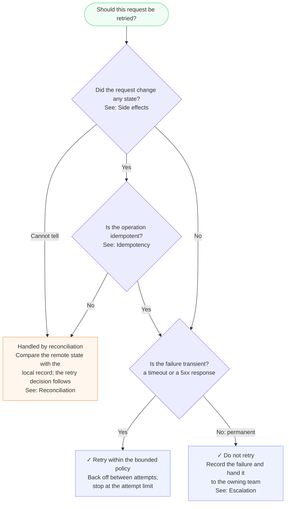

# Decision Diagram Format

Use for one decision a reader makes while reading a
guideline, runbook or policy: "given X, what do I do?"
Not for structure (pipelines, lifecycles, topologies):
those answer no question. Structure uses the types in
[diagram-types.md](diagram-types.md).

Where this format conflicts with a general rule in
SKILL.md, this format wins. The overrides are listed at
the end.

## Content rules

- One diagram, one question. The start node states it
  ("Should this request be retried?").
- Every diamond is a condition the text states, in the
  text's words. Every result box is an action the text
  states. Where the text is silent, the diagram is
  silent: no invented fall-through, no default leaf.
- Order the questions as the text orders them
  (first-match tables: row order).
- No rule keywords (MUST, SHOULD) in nodes. Rule strength
  stays in prose.
- No labels: no "Q1:", no "RESULT", no "Start:", no
  numbering. A glyph marks the box's role instead: `✓`
  opens a result box, `⚠` opens a no-match box. Plain
  text glyphs (U+2713, U+26A0), no emoji variation
  selector, no other glyphs.
- A node may end with `See: <Section name>` when the
  reader will want the text. One section per node. Never
  the section the diagram sits in.

## Shape

```
flowchart TB
  start(["<the question>"])
  q1{"<condition?><br/>See: <Section>"}
  r1["✓ <action><br/><detail><br/>See: <Section>"]
  h1["<hand-off to another section><br/>See: <Section>"]
  x1["⚠ <no match><br/>See: <Section>"]
  start --> q1
  q1 -->|"Yes"| r1
  q1 -->|"No: <why>"| q2
  click r1 "<page url>#<heading anchor>" "<Section>"
  style start fill:#f0fdf4,stroke:#4ade80
  style r1 fill:#eef2ff,stroke:#818cf8
  style h1 fill:#fff7ed,stroke:#fb923c
  style x1 fill:#fef2f2,stroke:#f87171
```

- `flowchart TB`, a plain tree. Stadium start (green).
  Diamonds for conditions. Rectangles for results
  (indigo, opened by `✓`), hand-offs to other sections
  (orange), no-match (red, opened by `⚠`).
- Node IDs: `start`, then `q1`..`qN` for conditions and a
  short noun for each result (`retry`, `escalate`). The
  template's `r1`, `h1` and `x1` only mark result,
  hand-off and no-match.
- Edge labels are short: `Yes`, `No`, or
  `No: nothing changed`. Edge labels cannot link.
- Line breaks with `<br/>`, three to five short lines per
  box. A `<br/>` label cannot be split across source
  lines, so a node line may exceed the usual column
  limit.
- Colour with `style` lines, not `classDef`. The fills
  are light, so the default text colour stays readable
  and no `color:` is needed. Palette:
  green `#f0fdf4` / `#4ade80` (start),
  indigo `#eef2ff` / `#818cf8` (result),
  orange `#fff7ed` / `#fb923c` (hand-off),
  red `#fef2f2` / `#f87171` (no match).
- Links: `click <id> "<url>" "<tooltip>"`, at most one
  per node and only on nodes that carry a `See:` line,
  placed before the `style` lines. Tooltip = section
  name. Keep the `See:` line in the label as well: some
  renderers drop `click`, and edges cannot link.

## Example



Four nodes carry a `See:` line and a matching `click`.
The `retry` node has neither: the diagram sits in the
retry policy section, and a node never points at the
section around it.

## Where it renders

- Judge width and arrow routing in the destination, not
  in the Mermaid CLI. `mmdc` still validates the syntax
  and is the preview step; a plain tree lays out far more
  compactly in Notion than the CLI's PNG suggests.
- Notion: the `click` URL is the page URL plus
  `#<heading block id>`; it opens in a new tab and shows
  the tooltip on hover. `<br/>` renders. Markdown-string
  labels (backticks) are not confirmed to render there.
- Markdown previews and the Mermaid live editor render
  `<br>`, `<br/>` and markdown strings alike. Plain long
  labels do not wrap anywhere.

## What not to do (each one cost a round of review)

- No subgraphs for row layout: they draw frames; with
  frames hidden the arrows float.
- No invisible edges (`~~~`) to align boxes: Notion's
  older Mermaid routes arrows into empty space.
- No shared end node: it pulls every result into one rank
  and the diagram gets 2,000 px wide.
- No markdown-string labels (backticks) when the target
  is Notion: `<br/>` is enough and renders everywhere
  that matters.
- Do not judge width with the Mermaid CLI: check in the
  destination.
- Do not link a node to the section the diagram is placed
  in.

## Overrides of SKILL.md rules

| SKILL.md rule | Decision diagrams |
|---|---|
| Max 15 nodes, split into subgraphs | Never subgraphs. More than one question means more than one diagram |
| Multi-zoom: detail subgraphs on request | One question per diagram. A hand-off box points at the section that holds the next question |
| Descriptive node IDs | `start`, `q1`..`qN`, a short noun per result |
| `classDef` with `color:` | `style` lines with the light palette above |
| `~~~` for layout control | Never |
| No emoji in node text | The text glyphs `✓` and `⚠` open result and no-match boxes. Nothing else |
| Preview judges layout | Preview validates syntax. Judge width in the destination |
