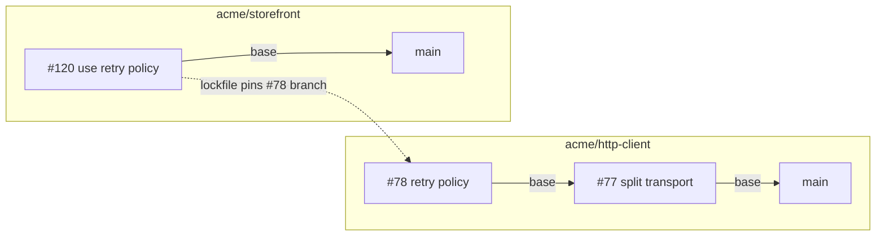
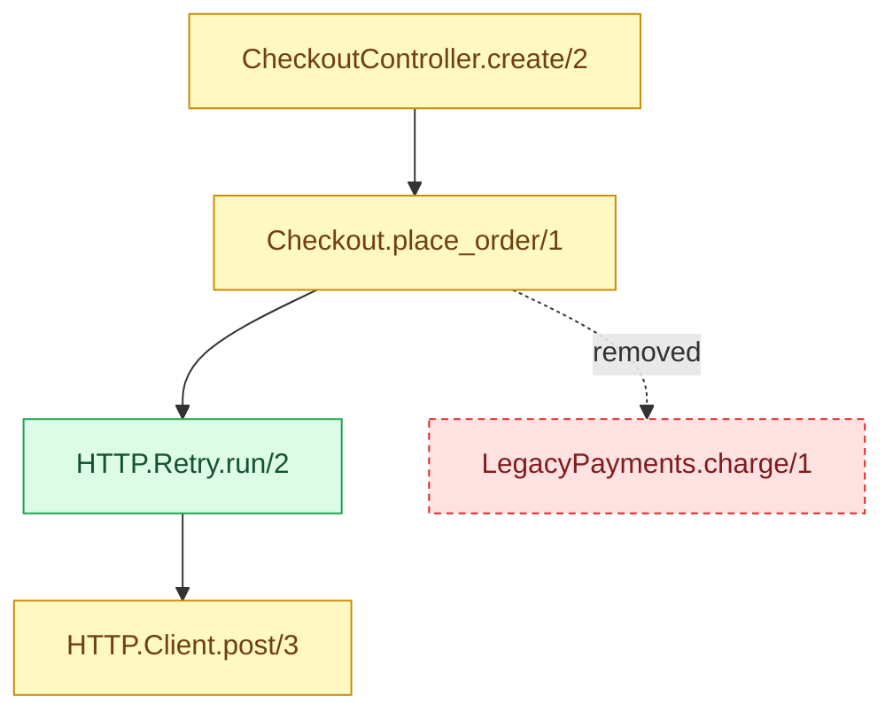
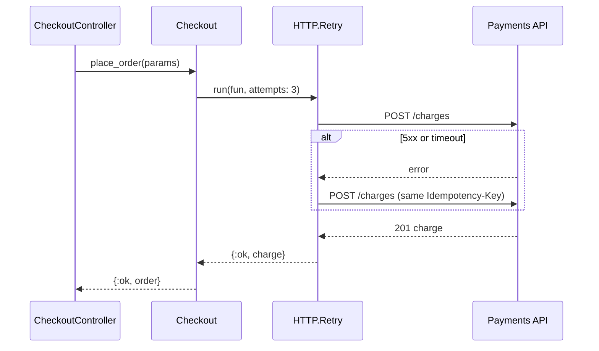

# Diagrams

Draw a diagram when it shows something the prose cannot: how several PRs relate, which
components a change touches, or the order of calls in a new flow. Skip it for a change
inside one module. A wrong diagram misleads faster than a wrong sentence, so build each
one from code that was read, not from the PR description.

Write diagrams as fenced `mermaid` blocks in `review.md`. GitHub and the HTML viewer
render them; in an editor they stay readable as text.

## Rules

- At most about 15 nodes. Split a bigger picture into two diagrams.
- Label nodes with the real identifiers: module, function, endpoint, queue, PR number.
- Quote labels that contain punctuation: `A["Foo.bar/2"]`, `P["#78 retail offers"]`.
- Every edge in a component or sequence diagram corresponds to a call or message in the
  code at the reviewed head. Put the `path:line` receipts in the chapter or the review
  log. If the diagram simplifies, its caption says so.
- Follow each diagram with one sentence that states what it shows, as a text
  alternative.
- Check the syntax before delivery. With the Mermaid CLI installed:
  `mmdc -i diagram.mmd -o /tmp/diagram.svg`. Otherwise use the
  [mermaid-master](../../../design/mermaid-master/SKILL.md) skill's validation step, or
  open `review.html` and look for a rendering error in place of the diagram.

## 1. PR graph

For stacks and multi-repository changes. Repositories as subgraphs, PRs as nodes, one
edge style per relation.

The `storefront` PR depends on the unreleased `#78` branch, so the library must release
before `#120` merges.

## 2. Changed components

For changes that touch three or more modules. Mark each node as added, changed, or
removed, and show unchanged neighbours only when they explain an edge.

Green is new, yellow is changed, red is removed; the dashed edge is the call the change
deletes.

## 3. New flow

For a new request, event, or job flow that crosses components. One sequence diagram per
flow; show error branches with `alt` only when the review discusses them.

A failed charge is retried up to three times inside `HTTP.Retry`; the controller sees
one result.
