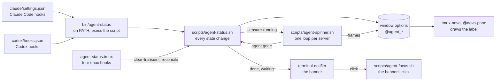
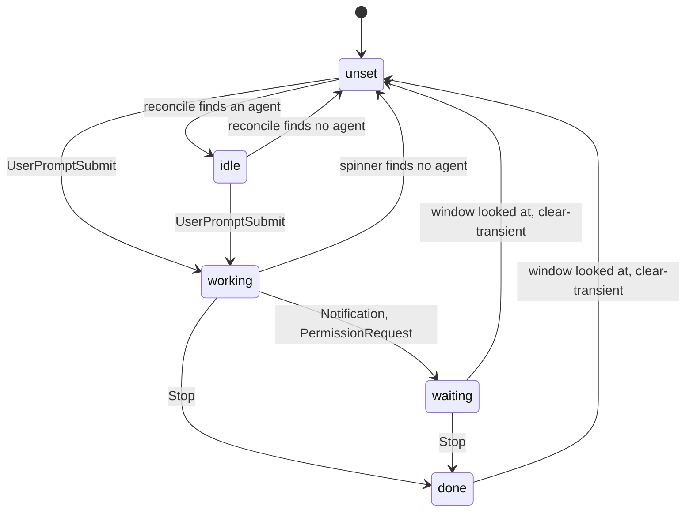
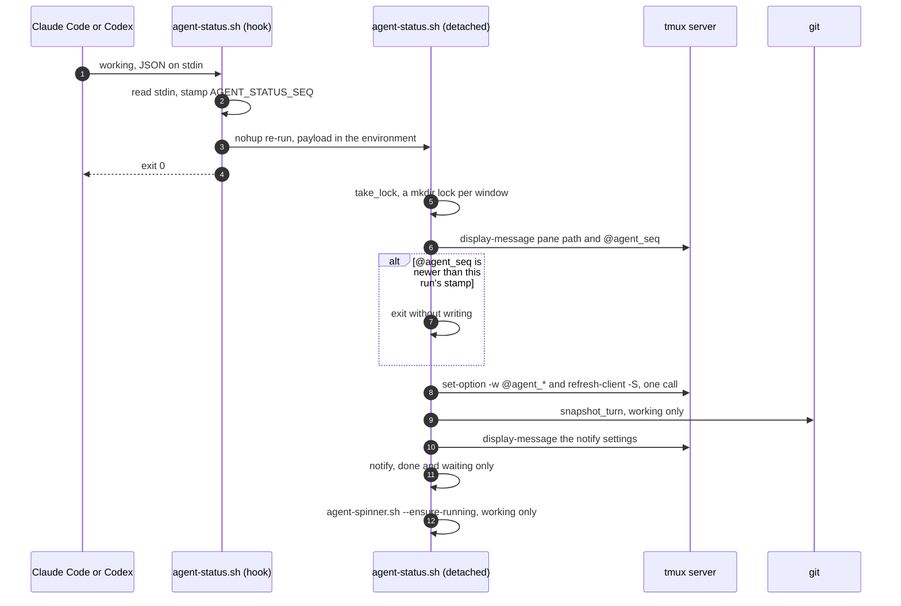
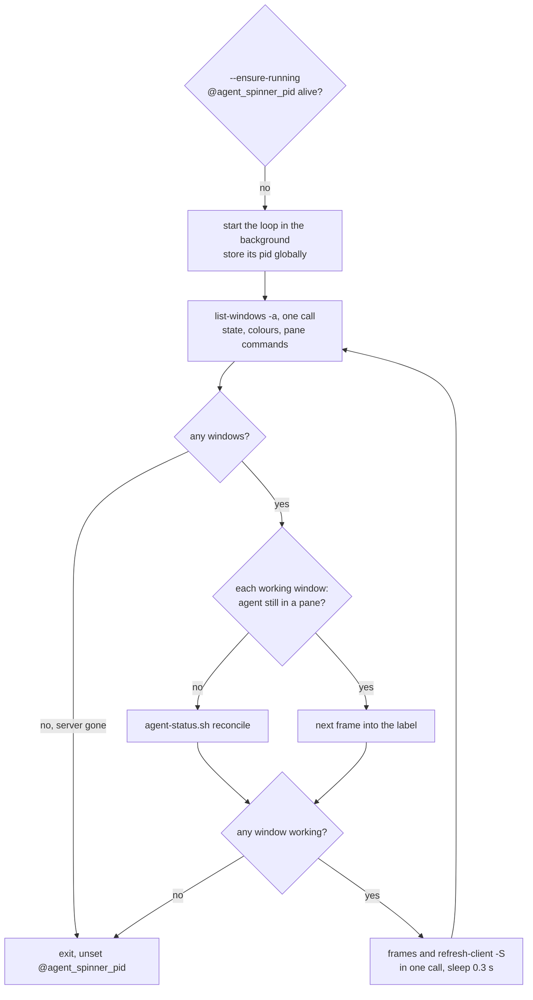
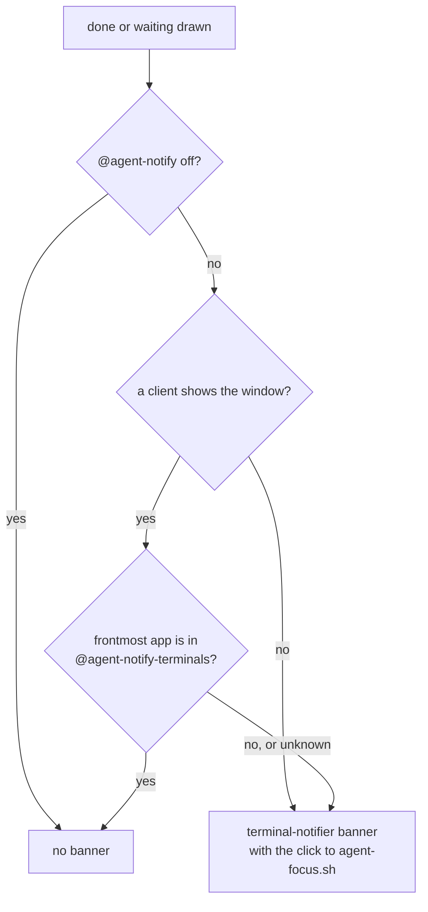
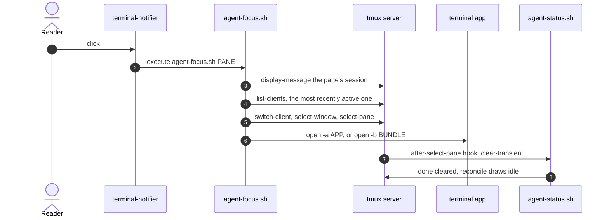

# tmux-agent-status: architecture

How agent events become a label in the window's tab, a spinner and a banner.
For what the plugin shows and how to configure it, see [README.md](README.md);
for how it sits next to tmux-review, see
[../tmux/ARCHITECTURE.md](../tmux/ARCHITECTURE.md).

Functions named here are in `scripts/agent-status.sh` unless another file is
given. `grep -n '^<name>() {' scripts/*.sh` finds any of them.

## The pieces

| File | Role |
|---|---|
| `agent-status.tmux` | Runs once when tmux loads its config. Sets four tmux hooks and nothing else: no bindings, no status format. |
| `bin/agent-status` | The command the harness hooks call, linked to `~/.local/bin/agent-status` by `install.sh`. Follows its own symlink and execs `scripts/agent-status.sh`, so the event JSON on stdin reaches it. |
| `scripts/agent-status.sh` | Every state change: draws the label, snapshots the repository, raises the banner, starts the spinner. |
| `scripts/agent-spinner.sh` | One background loop per tmux server that animates every window in `working`. |
| `scripts/agent-focus.sh` | Run by the banner's click. Puts the reader on the agent's pane and raises the terminal. |
| `scripts/variables.sh` | Glyphs, colours, text limits, lock timings, default terminal list and sounds. |
| `sounds/` | Two sounds that `install.sh` copies into `~/Library/Sounds`. |

The plugin does not draw the status bar. It writes window options, and the
bar's format reads them: tmux-nova's `@nova-pane` in `.tmux.conf` shows
`@agent_status_active` for the active window and `@agent_status` for the rest.

## What calls it

| Caller | Event | Command |
|---|---|---|
| Claude Code (`claude/settings.json`) | `SessionStart` | `agent-status --agent claude clear` |
| | `UserPromptSubmit` | `agent-status --agent claude working` |
| | `Notification` | `agent-status --agent claude waiting` |
| | `Stop` | `agent-status --agent claude done` |
| Codex (`codex/hooks.json`) | `SessionStart`, `SessionEnd` | `agent-status --agent codex clear` |
| | `UserPromptSubmit` | `agent-status --agent codex working` |
| | `PermissionRequest` | `agent-status --agent codex waiting` |
| | `Stop` | `agent-status --agent codex done` |
| tmux (`agent-status.tmux`) | `after-select-window`, `after-select-pane` | `agent-status.sh clear-transient #{pane_id}` |
| | `client-attached`, `client-session-changed` | `agent-status.sh reconcile #{pane_id}` |
| `agent-spinner.sh` | a working window with no agent left in it | `agent-status.sh reconcile <window>` |

The tmux hooks go in slot `[50]` of each hook array (`AGENT_STATUS_HOOK_SLOT`),
so they leave a user's own `[0]` alone and a reload replaces rather than adds.
Each runs with `run-shell -b`.

## The states

- A harness event sets its state from any state; the diagram shows the usual
  paths. `clear` (session start, and session end for Codex) returns any state
  to unset and deletes the turn's snapshot.
- `clear-transient` drops only `waiting` and `done`, which looking at the
  window acknowledges, then runs `reconcile`. `working` is left alone.
- `reconcile` re-derives the state from what is running, because events get
  lost and an agent killed mid-turn never sends `Stop`. An agent is a pane
  whose `pane_current_command` is `codex`, `claude` or a version number
  (`agent_in_window`). State set and no agent: clear it. An agent and no state:
  draw `idle`, the harness marker alone.
- `idle` is only ever drawn by `reconcile`; no harness sends it.

## One event, end to end

- **The detach.** Harnesses give a hook about five seconds, and on a loaded
  machine the tmux round trips can outrun that. So the hook reads its stdin,
  re-runs itself detached with the payload in the environment
  (`AGENT_STATUS_DETACHED`, `AGENT_STATUS_PAYLOAD`), and returns at once.
  `clear-transient` and `reconcile` never detach: they come from tmux's
  `run-shell -b`, which reaps the process group when its command returns.
- **The order.** Once detached, runs race. The stamp is taken before the
  detach, in the order the harness called, and each write stores it in
  `@agent_seq`. A run that finds a newer stamp already written leaves the
  window alone. `clear` writes its own stamp too, so a run started before it
  cannot repaint what it cleared.
- **The lock.** `take_lock` makes `$TMPDIR/agent-status<window>.lock`. It
  retries for about three seconds and breaks a lock older than ten seconds; if
  it never gets one it goes ahead anyway.
- **The writes.** Every option for a state goes out in one tmux call with
  `refresh-client -S`, so the tab redraws once. For `working` they include the
  turn's start time, the prompt, the working directory and `HEAD`.
- **The snapshot.** For `working`, `snapshot_turn` writes a git index of the
  working tree into `$TMPDIR/agent-status<window>.turn/`, after the tab is
  drawn and still under the lock. The `done` banner diffs against it.

## The spinner

One loop serves every window on the server. Each tick reads everything it needs
in one `list-windows` call and writes every frame in one more, because tmux
calls on this path delayed other plugins' keys. Redraws are pushed with
`refresh-client -S` rather than waiting for `status-interval`. The frames and
the interval are in `scripts/variables.sh`; `AGENT_SPINNER_INTERVAL` overrides
the interval.

## The banner

- **Suppression** needs two facts. tmux knows whether a client shows the window
  (`window_active_clients`); macOS knows which app is in front (`lsappinfo`).
  A terminal behind a browser still counts as not looking. An unknown
  frontmost app gets a banner.
- **`done`** carries how long the turn took, the prompt, the reply (Codex's
  `last_assistant_message`, or the last assistant paragraph of Claude Code's
  transcript), the commits since the turn's `HEAD`, and a diffstat against the
  turn's snapshot.
- **`waiting`** carries the harness's message, or "waiting for your input".
- **Sound** is `@agent-notify-sound-waiting` or `@agent-notify-sound-done`,
  `none` for silence.
- **Without terminal-notifier** it falls back to `osascript display
  notification`, which has no click action.

`agent-focus.sh` runs with Notification Center's minimal `PATH`, so it puts
Homebrew's back first. It raises `@agent-notify-app` when set; otherwise the
first `.app` bundle above the tmux client's process, or the bundle id the
client inherited in `__CFBundleIdentifier` (iTerm2 runs its shells under a
daemon with no bundle above it). Each click is logged to
`$TMPDIR/agent-focus.log`.

## State

| Where | What | Written by |
|---|---|---|
| window options | `@agent_state`, `@agent_state_colour`, `@agent_glyph`, `@agent_glyph_colour`, `@agent_status`, `@agent_status_active`, `@agent_seq` | each drawn state; `clear_status` unsets them |
| window options, `working` only | `@agent_started`, `@agent_prompt`, `@agent_head`, `@agent_cwd` | the `working` event |
| global option | `@agent_spinner_pid` | `agent-spinner.sh` |
| `$TMPDIR/agent-status<window>.lock/` | the per-window lock and when it was taken | `take_lock`, `release_lock` |
| `$TMPDIR/agent-status<window>.turn/` | the turn's index, objects and repository path | `snapshot_turn`; removed by `clear` |
| `$TMPDIR/agent-focus.log` | what each click raised | `agent-focus.sh` |

Settings it reads (global options, all optional): `@agent-notify`,
`@agent-notify-terminals`, `@agent-notify-sound-done`,
`@agent-notify-sound-waiting`, `@agent-notify-app`. `.tmux.conf` sets the two
sounds.

## Tests

`./run_tests` runs `tests/agent_status_test.sh`, which sources the three
scripts and stubs `tmux`, `git`, `ps`, `lsappinfo`, `osascript`, `open` and
`date` as shell functions. Later sections run the real script with stub `tmux`
and `terminal-notifier` executables on `PATH`, build throwaway git repositories
for the snapshot, check that a hook returns at once, and load
`agent-status.tmux` into a throwaway server (`tmux -L agent-status-hooks-$$`)
to check its hook slots. `./run_coverage --min 100` is part of
`tmux/check.sh`: every line of the plugin has to be reached.
