# tmux-review: architecture

How the review window is built and how its parts talk to each other. For what
the plugin does and how to use it, see [README.md](README.md); for how it sits
next to tmux-agent-status, see [../tmux/ARCHITECTURE.md](../tmux/ARCHITECTURE.md).

Everything named here is a function in `scripts/review.sh` unless another file
is given. `grep -n '^<name>() {' scripts/review.sh` finds any of them.

## The pieces

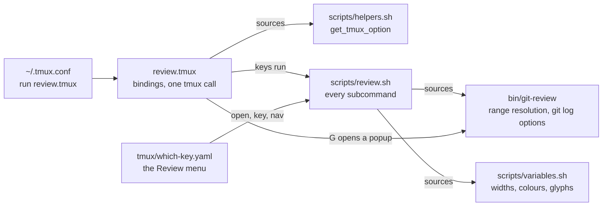

| File | Role |
|---|---|
| `review.tmux` | Runs once when tmux loads its config. Binds `prefix g` (open a review) and `prefix G` (uncommitted changes in a popup), set with `@review-key` and `@review-wip-key`, and the copy-mode-vi keys that route into the review. Every binding goes out in a single `tmux` call. |
| `scripts/review.sh` | Everything else, as subcommands of one script: `open`, `diff`, `header`, `gutter`, `sidebar`, `jump`, `nav`, `key`, `quit`, `retarget` (`main`). Sourced by the tests, so it dispatches only when run. |
| `scripts/variables.sh` | The numbers and colours the window is drawn with: list width share and bounds, the diff's minimum width, the comments pane width, glyphs. Plain shell variables, not tmux options. |
| `bin/git-review` | A `git review` subcommand that prints a range's diff. `review.sh` sources it for `gr_resolve_range` and `gr_log_opts`; the popups run it. |

## The review window

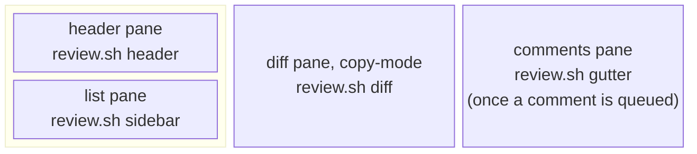

One process per pane, all of them `review.sh` with a subcommand:

| Pane | Process | What it does |
|---|---|---|
| diff | `review.sh diff <range> <width>` (`diff_pane_cmd`) | Runs `git log` with delta as the pager, straight into the pane, and copies delta's bytes into the render cache with `tee`. Then blocks, so the pane stays up. |
| list | `review.sh sidebar ...` (`sidebar`) | The main loop: reads the diff's state, keeps the row map, draws the commit list, prepares the header's frames, draws the comments pane, reads keys, runs folds. |
| header | `review.sh header <diffpane>` (`header`) | Shows a frame the list prepared. Its own keys only move between the range row and the agent row, and Enter opens the picker for either. |
| comments | `review.sh gutter <diffpane>` (`gutter`) | Created and removed by `gutter_sync` as the queue fills and empties. Forwards its keys to the list. |

`open` builds the window with `split-window` calls: the diff in a new window,
the header split off its left, the list under the header. The list is zoomed
while the diff loads, so the placeholder is drawn at the width the list will
keep. Widths come from `columns_for` and `reserve_for`, which hold back a
column for the comments pane's marks before delta renders, so opening that
pane later moves nothing. Later relayouts go through `review_layout` and
`relayout`, which write tmux's own layout string.

How the parts exchange data:

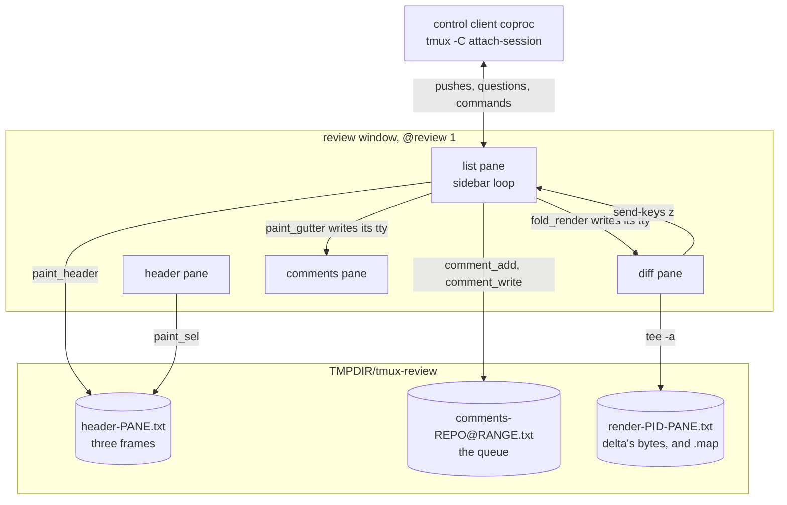

`z` means nothing to the list or the header. It is sent to wake a loop that is
waiting on a key: the diff sends it when it has revealed itself and when it has
finished loading, the header when its selection changed, and the list to the
header when a frame changed.

## A review's life

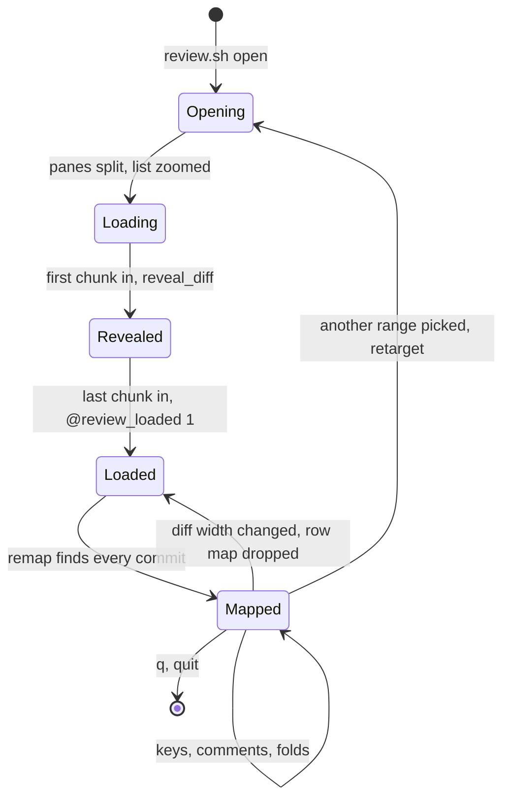

- **Loading.** The list draws a placeholder and drops keys; there is no row map
  to act on yet. The diff loads in up to two chunks (`plan_chunks`), so the
  reader can start on the first commit while the rest renders.
- **Revealed.** After the first chunk, `reveal_diff` puts the diff in
  copy-mode at the top, unzooms the list and sets `@review_hist_base`.
- **Loaded.** `diff_pane_cmd` sets `@review_loaded` and `@review_render_w`.
  The list's next turn builds the row map.
- **Retarget.** Picking another range in the header opens a new review from the
  old diff pane and closes the old window (`retarget`).
- **Quit.** `q` from any pane selects the window the review was opened from
  and kills the review window (`quit`). `sidebar_exit` stops the control client
  and removes the render cache.

## Opening a review

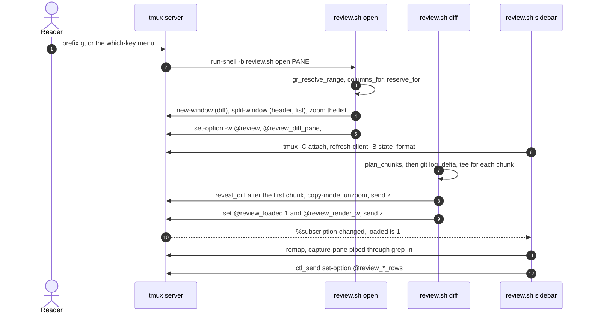

## Talking to tmux: the control client

The list keeps one control-mode client as a coproc (`start_subscription`) and
uses it three ways:

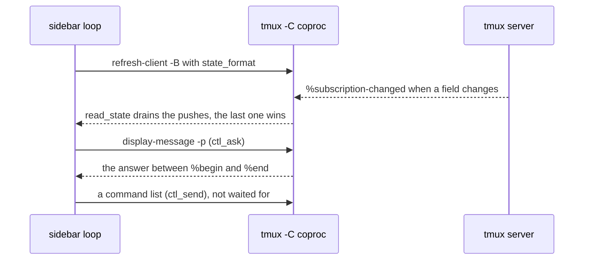

- **Pushes.** `state_format` has 17 fields: copy-mode, the scroll basis and
  position, the cursor row, the pane and window sizes, zoom, focus, search,
  `@review_loaded`, the history size, the header's selection and open request,
  the active pane, and whether the window is active. tmux re-evaluates a
  subscription about once a second, so a turn that needs fresh numbers asks
  instead.
- **Questions.** `ctl_ask` sends `display-message -p` and takes the one line
  between `%begin` and `%end`. `ask_state` uses it while the comments pane is
  up, before the first push, and on the turn after a fold.
- **Commands.** `ctl_send` writes a command list and does not wait. tmux
  answers one client's commands in order, so the next question sees their
  effect.

Each of the three falls back to a tmux process of its own when the client is
not up. A round trip down the client costs about 0.5 ms against about 5 ms for
a new tmux process.

## The list's loop

The real turn also tracks resizes, focus changes, the drag clamp and the agent
guess. This is its spine:

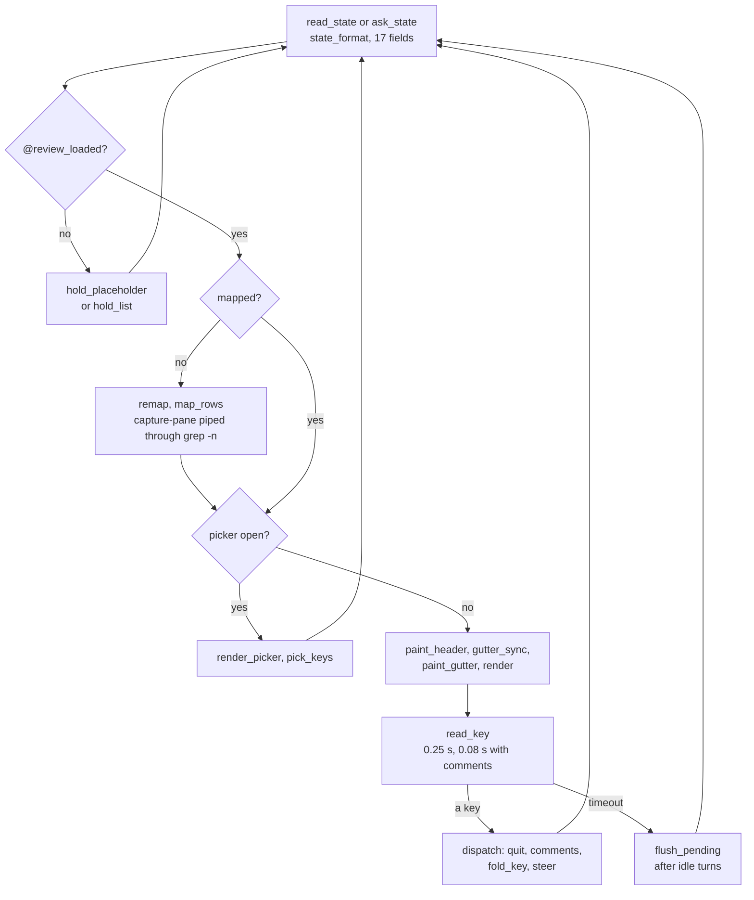

- `read_key` is the loop's only wait. It returns on a key or after its
  timeout, so the loop turns four times a second when nothing happens; `render`
  redraws the list only when something it shows has changed.
- Moves are drawn at once and sent later. `steer` and `jump` paint the new
  highlight and record `pending_row`; `flush_pending` moves the diff once the
  reader pauses, so holding `j` costs one tmux call rather than one per key.
- Anything that is not a move flushes the pending move first, because `c` and
  the folds read the diff's cursor.

## Keys

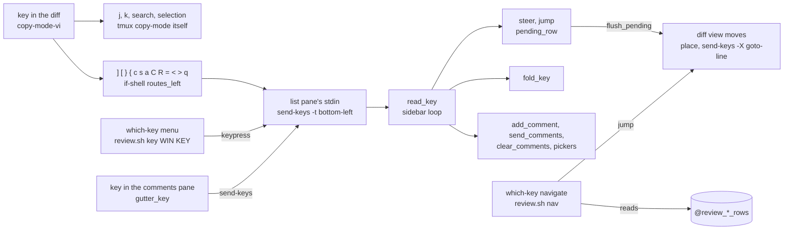

- `review.tmux` binds the routed keys in copy-mode-vi behind format guards:
  `in_review` (the window has `@review` and the pane is in copy-mode) and
  `routes_left` (and the pane is not at the left edge, so a key never routes
  back to where it came from). Outside a review the keys keep tmux's meaning.
- The target is `{bottom-left}`, the list pane: `send-keys -t` does not expand
  formats, so a stored pane id cannot be used, and the list is the lower of
  the two left panes by construction.
- `n` and `N` search again when a search is active and route otherwise; `y`
  routes only while the list is asking a yes/no question (`@review_asking`);
  `Enter` copies without leaving copy-mode.
- `read_key` turns arrows, page keys, Home, End and `gg` into names (`j`, `k`,
  `page_up`, `first`, ...), so every caller sees the same key whichever way it
  was typed.

## The row map

The list's index of the diff. Every row is a scrollback row counted from the
top of the history, which is what tmux's `goto-line` and the copy-mode formats
work in.

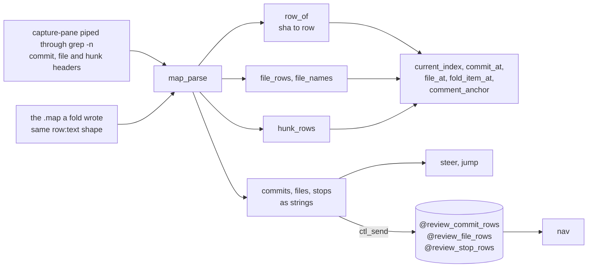

- `map_rows` builds it, `remap` wraps that and moves `map_gen`, which tells the
  comments pane to anchor its comments again.
- The map is complete (`mapped=1`) once every commit in the list has a row.
  Until then it is rebuilt on every turn.
- A change in the diff's width means tmux reflowed the scrollback, so the map
  is dropped and rebuilt. Opening or closing the comments pane is the
  exception: its column was reserved before delta rendered, so no row moves.
- Hunk boxes are mapped for folding but are not stops: `n` and `N` stop at
  commits and files only.

## The header and the pickers

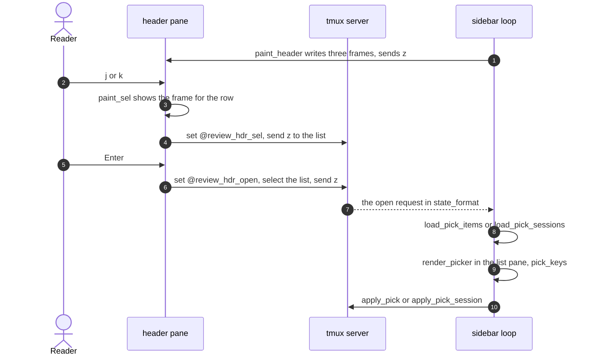

- The header shows the range, the chosen agent with the number of comments
  queued, and a bar of what the range adds and removes (`render_header`). The
  list writes three versions of it, one per selection, to `header-PANE.txt`,
  so moving the selection in the header costs no round trip.
- The range picker offers the current range, the last n commits, a typed
  range, uncommitted and staged changes when there are any, and up to twelve
  branches and twelve stashes. A range retargets the review; uncommitted, staged and stash open `git-review` in a
  popup.
- The agent picker lists every pane running `claude`, `codex` or a version
  number (Claude Code's process name), with its tmux-agent-status state beside
  it, `idle` when none is set. The choice goes into `@review_agent_pane`,
  `@review_agent_label` and `@review_agent_guessed`.
- Once the diff has loaded, `preselect_agent` guesses an agent if none is set:
  the same tmux session scores 3, the same working directory 2, a parent or
  child directory 1. A tie goes to the deeper directory, and a tie that remains
  picks nothing.

## Comments

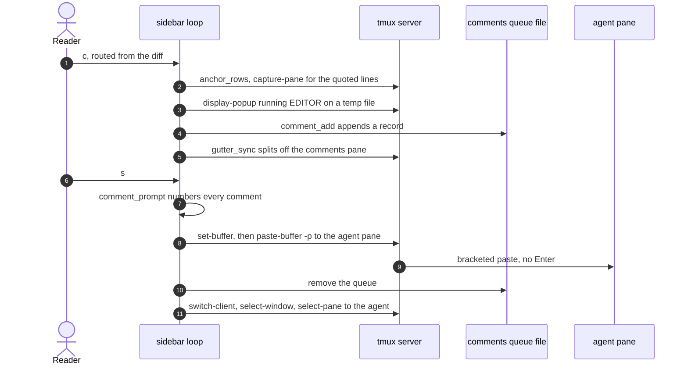

The queue is `${TMPDIR}/tmux-review/comments-<repo@range>.txt`, keyed by
repository and range so it outlives the window (`comment_file`). Each record is
six fields separated by `\x1f` and ends in `\x1e`:

| Field | Holds |
|---|---|
| `commit` | the abbreviated sha the comment was written in |
| `file` | the file's path |
| `first`, `last` | the line numbers the comment covers |
| `block` | the quoted lines, at most 60 rows |
| `body` | what the reader wrote |

`comment_write` rewrites the file through a temporary file and a rename, and
removes it when the queue is empty. `e` and `d` edit and delete the comment the
reader stands on in the comments pane; `R` clears the queue after asking.

Each comment is drawn against a row of the diff, worked out again whenever the
row map changes (`comment_anchor`):

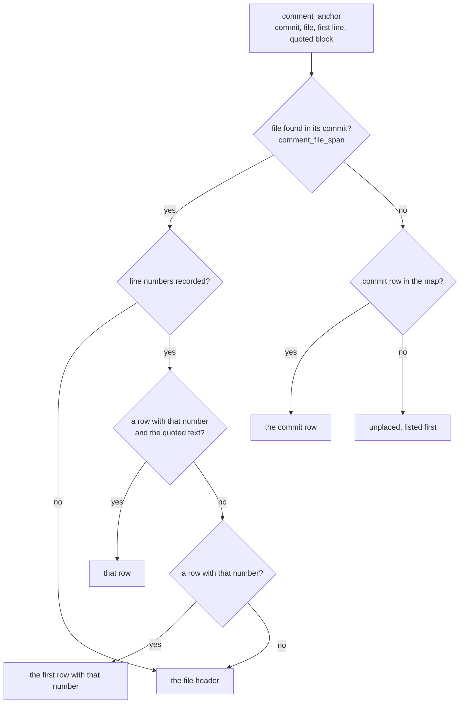

`comment_rows` anchors every comment and sorts them up the diff, unplaced
first. The comments pane is 1 column wide for the marks alone, or 40 columns
(`gutter_cells`) when expanded with `C` and the list can spare the width
(`gutter_want`, `gutter_can_expand`).

## Folding

`=`, `<` and `>` collapse and open the commit, file or hunk under the cursor,
after vim-fugitive's keys for its inline diffs. tmux cannot hide rows of a
pane's history, so a fold writes the pane again from the bytes delta wrote the
first time, with the collapsed items left out.

The set of collapsed items lives in the list's `folded` array and is not saved.
Items are named by position, not by row, because rows move on every rewrite and
positions do not:

| Item | Name | Example |
|---|---|---|
| commit | abbreviated sha | `21db538` |
| file | commit and its ordinal among that commit's files | `21db538/2` |
| hunk | file and its ordinal among that file's hunks | `21db538/2/3` |

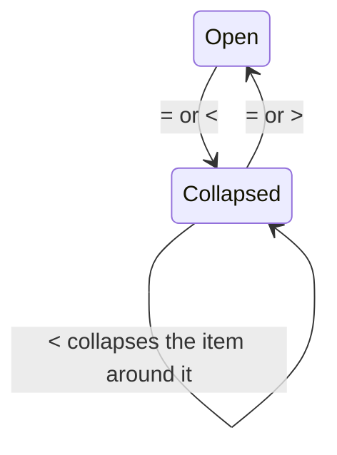

A collapsed item keeps its header rows: the `commit` row, the file header, the
hunk's box. Its body becomes one row saying what it held, fitted to the width
delta rendered at. That is what keeps the row map, the list highlight, the
jumps and the comment anchors working. Collapsing a commit and opening it again
brings back whatever was collapsed inside it.

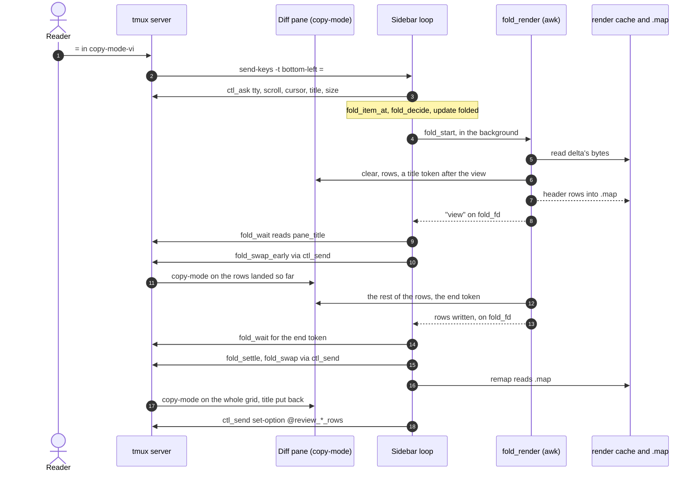

- **The cache.** `diff_pane_cmd` tees delta's output to
  `render-<server pid>-<pane>.txt`, so the cache is the pane's content byte for
  byte. With nothing collapsed, `fold_render` writes it back unchanged.
- **The write.** `fold_render` is one awk pass, written straight to the diff
  pane's tty. The clear goes out with the first row, so a cache that cannot be
  read leaves the pane alone. Copy-mode shows a copy of the grid taken when it
  was entered, so the reader keeps seeing the old diff while the new one lands.
- **The tokens.** An OSC 2 title after the last row says tmux has parsed
  everything before it, because it travels in the same byte stream. A second
  token after the row the view ends on lets the reader see the fold before the
  rows below them have landed.
- **The swaps.** `fold_swap_early` enters copy-mode on what has landed and
  places the view from copy-mode's own scroll after `history-top`, because
  `#{history_size}` keeps counting rows that land after the entry.
  `fold_settle` enters it again on the whole grid under wherever the reader
  has got to, and puts the pane's title back.
- **The map.** The render writes every header it emits to `.map` in the shape
  `grep -n` reads off a capture. `fold_key` builds the map from it right after
  the swap is sent, while tmux copies the grid into copy-mode, but only when
  `#{history_size}` plus `#{cursor_y}` equals the rows written, which is when
  no row wrapped. Otherwise the next turn captures the pane.
- **The cursor.** It lands on the item's header unless it was already on one of
  the header's rows (`fold_place`). The view keeps its top when the header is
  in view.

On a 40,000-row range the fold appears in about 0.3 s with the reader halfway
down, and the next key is answered after about 0.6 s; most of both is tmux
parsing the rewrite. Ranges of about 1,500 rows take tens of milliseconds.

## State kept outside the loop

Options on tmux objects:

| Option | Scope | Written by | Read by |
|---|---|---|---|
| `@review` | window | `open` | the binding guards in `review.tmux` |
| `@review_return` | window | `open` | `quit`, `retarget` |
| `@review_diff_pane`, `@review_list_pane` | window | `open` | `keypress`, `nav`, `gutter`, `retarget` |
| `@review_gutter_w` | window | `open` | `sidebar`, as the comments pane's reserve |
| `@review_loaded` | window | `diff_pane_cmd` | the list, through `state_format` |
| `@review_render_w` | diff pane | `diff_pane_cmd` | `fold_key` |
| `@review_hist_base` | diff pane | `reveal_diff`, `settle_view`, the list, `fold_swap`, `fold_swap_early` | everything that turns a screen row into a scrollback row |
| `@review_commit_rows`, `@review_file_rows`, `@review_stop_rows` | diff pane | `map_rows` | `nav` |
| `@review_hdr_sel`, `@review_hdr_open` | window | `header_key` | the list, through `state_format` |
| `@review_agent_pane`, `@review_agent_label`, `@review_agent_guessed` | window | `preselect_agent`, `apply_pick_session` | `sidebar` at start, so a retarget keeps the agent |
| `@review_asking` | window | `clear_comments` | the `y` routing in `review.tmux` |

Files under `${TMPDIR}/tmux-review/`:

| File | Written by | Removed by |
|---|---|---|
| `comments-<repo@range>.txt` | `comment_add`, `comment_write` | `send_comments`, `clear_comments`, `comment_write` when empty |
| `header-<pane>.txt` | `paint_header` | nothing |
| `render-<server pid>-<pane>.txt` and `.map` | `diff_pane_cmd`, `fold_render` | `sidebar_exit` |

Elsewhere: a `review-comment.XXXXXX` temporary file for the editor, and the
tmux paste buffer `review-comments`.

## Tracing

With `REVIEW_TRACE` set in the server's environment before a review opens,
`trace` appends `<EPOCHREALTIME> <label>` lines to that file:

| Stage | Labels |
|---|---|
| loading | `diff-start`, `chunks-planned:N`, `chunk-rendered:<chunk>`, `revealed`, `loaded` |
| the list | `sidebar-start`, `sidebar-commits-loaded`, `subscribed`, `list-drawn` |
| the row map | `map-rows-start`, `map-rows-done:<found>/<commits>` |
| a fold | `fold-start`, `fold-asked`, `fold-early`, `fold-written`, `fold-waited`, `fold-swapped` |

A `found` that differs from `commits` means the map is rebuilt on every turn.

## Tests

`./run_tests` runs `tests/review_test.sh`, which sources `scripts/review.sh` and
stubs `tmux` and `git` as shell functions for its unit sections.
`REVIEW_TEST_SCOPE=unit` skips the live sections, which open real reviews on
throwaway servers (`tmux -L review-*-$$ -f /dev/null`) and are cleaned up by
`clean_sockets` on exit. `./run_coverage` measures line coverage with bash's
xtrace, without installing anything; `--scope unit` counts what the unit
sections reach. `tmux/check.sh` runs shellcheck, `bash -n` and the tests for
both plugins.
