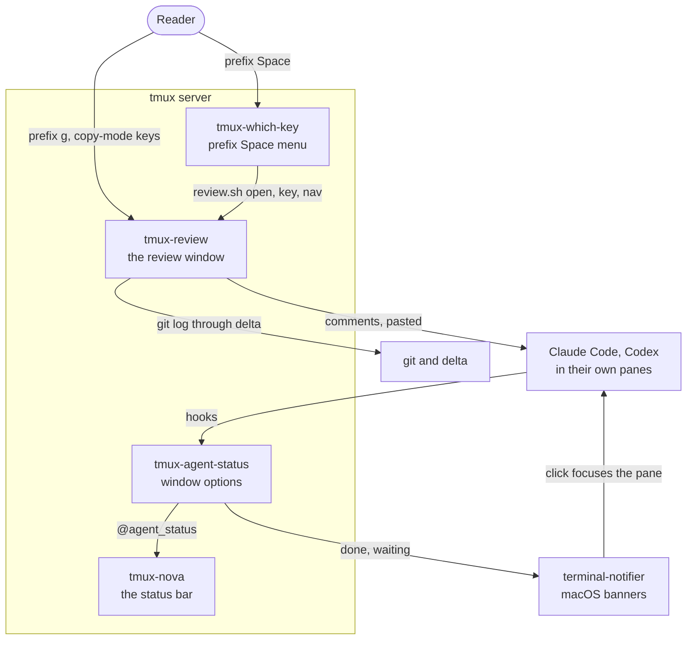
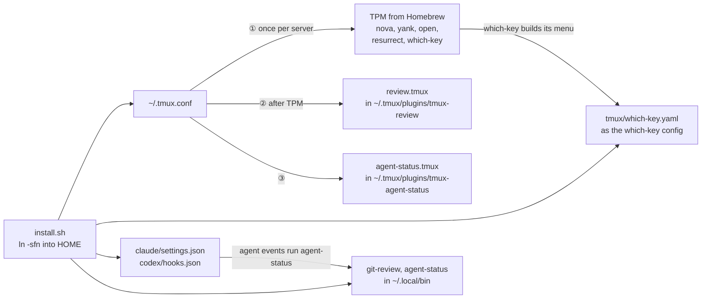
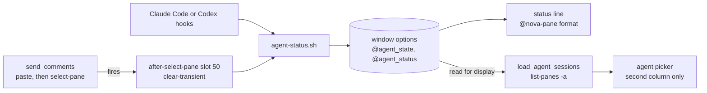

# tmux plugins: architecture

This repository carries two tmux plugins of its own, both bash:

- **tmux-review** opens a review window for a git range: the diff in one pane,
  read in copy-mode, a commit list that follows the reader, a header, and a
  comments pane whose queue is pasted into an agent's pane. See
  [tmux-review/ARCHITECTURE.md](../tmux-review/ARCHITECTURE.md).
- **tmux-agent-status** shows what each Claude Code or Codex session is doing
  in its window's tab, animates it while the agent works, and raises a macOS
  banner when it stops. See
  [tmux-agent-status/ARCHITECTURE.md](../tmux-agent-status/ARCHITECTURE.md).

`tmux/` holds what they share: the check script and the which-key menu. This
page covers what spans both: how they load, where they meet, and how they are
checked.

## In context

## How the plugins load

- `install.sh` links `.tmux.conf`, both plugin directories under
  `~/.tmux/plugins/`, `bin/git-review` and `bin/agent-status` into
  `~/.local/bin`, the Claude Code and Codex hook files, and, once TPM has
  installed tmux-which-key, the which-key menu. It also copies
  tmux-agent-status's sounds into `~/Library/Sounds`.
- `.tmux.conf` runs TPM once per server, guarded by `@tpm_loaded`. It runs
  `review.tmux` after TPM so tmux-yank cannot overwrite the copy-mode-vi Enter
  binding, then `agent-status.tmux`.
- Neither plugin is a TPM entry; both are symlinks into this repository, next
  to TPM's own checkouts.
- `tmux/rebuild-which-key.sh` rebuilds the which-key menu by hand, because
  `.tmux.conf` turns the plugin's build on load off.

## Where the two plugins meet

- tmux-review reads one tmux-agent-status option, `@agent_state`, to show
  beside each agent in its picker (`load_agent_sessions`). Whether a pane is an
  agent is decided by `pane_current_command` in both plugins, because
  `@agent_state` outlives the agent.
- Sending comments ends with `select-pane` on the agent's pane
  (`send_comments`), which fires tmux-agent-status's `after-select-pane[50]`
  hook and clears a `done` or `waiting` label. The two meet only through tmux
  hooks and options; neither sources or calls the other.
- Both recognise Claude Code by a version number as well as `claude`, because
  that is the process name Claude Code runs under. `.tmux.conf`'s
  `automatic-rename-format` maps it back to `claude` for window names.

## Checks and tests

`tmux/check.sh` is the gate for both plugins:

| Step | What runs |
|---|---|
| shellcheck | `shellcheck -f gcc -x` over both plugins' scripts, `tmux/` and `install.sh` |
| syntax | `bash -n` on each script |
| tests | `tmux-review/run_tests`, then `tmux-agent-status/run_tests` |
| coverage | `tmux-agent-status/run_coverage --min 100`; tmux-review's coverage is reported by its own `run_coverage`, not gated |

Both suites source their scripts, stub `tmux` for their unit sections, and
start throwaway servers with `tmux -L <name> -f /dev/null` for their live ones,
so a run never touches the server it is started from.
